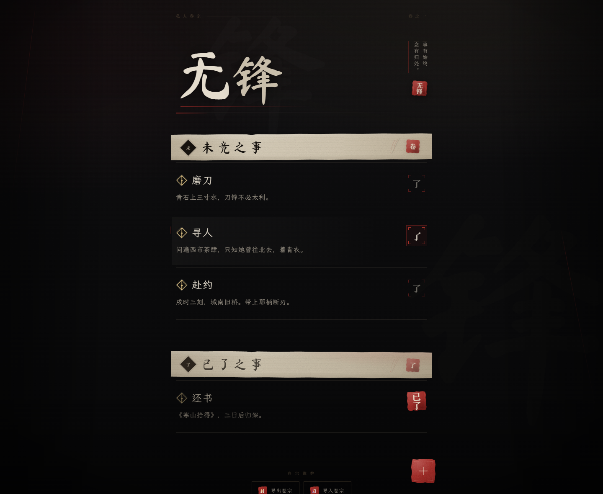
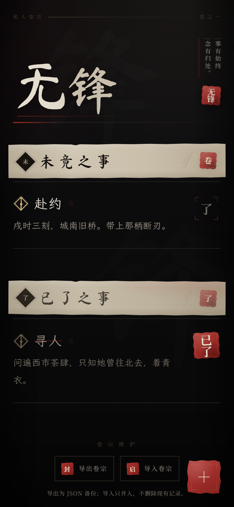
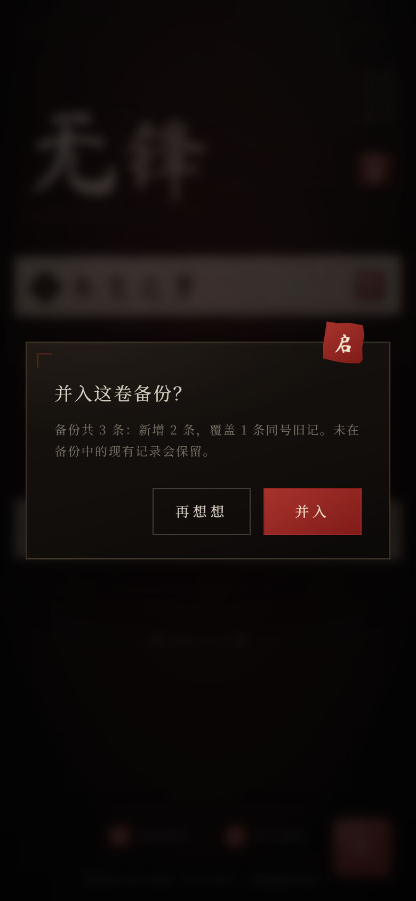
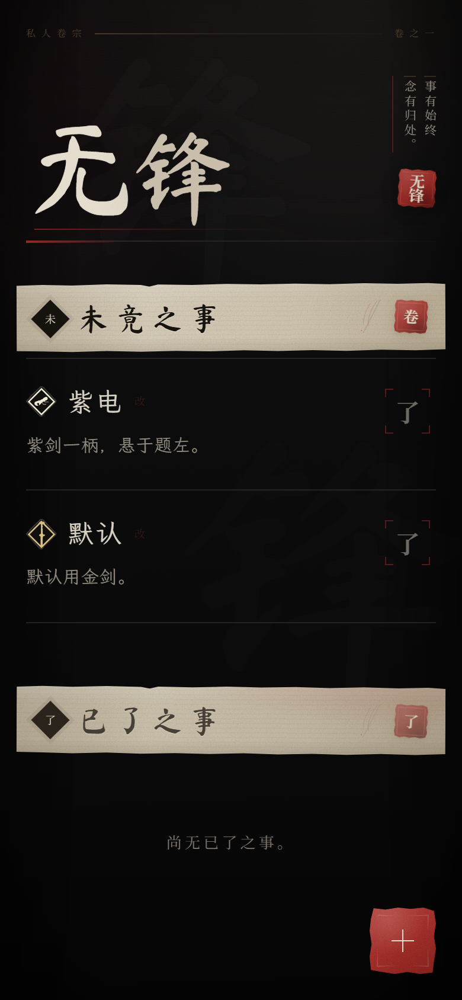

# 无锋 · WUFENG

> 事有始终，念有归处。
>
> 未竟之事，记于纸上。已了之事，封于朱印。

**当前版本：2.5.0** · [变更记录](CHANGELOG.md)

**在线版本**：https://wyldeye10-spec.github.io/wufeng/

以《影之刃零》的黑暗武侠气质为灵感的极简私人备忘录。它不像待办软件，更像一本存在
于黑暗江湖里的私人卷宗：记事、改事、落印、留档，仅此而已。









## 功能范围

只保留事项本身的七件事，另加卷宗维护的导出/导入；不增加账号、云同步、分类、标签、
优先级、截止日期、提醒、统计或任何导航系统：

- 新增事项
- 查看事项
- 编辑事项
- 删除事项（二次确认）
- 朱红「已了」落印
- 撤销完成
- 本地持久保存
- 事项印记（金剑 / 紫剑 / 白卷，默认金剑）
- 导出卷宗（UTF-8 JSON 备份）
- 导入卷宗（并入式恢复，同编号以备份为准）

标题严格限制 8 个字符，内容严格限制 50 个字符，按用户可感知的 Unicode 字素计数
（`Intl.Segmenter`，退化路径为码点）。中文输入法组合期间不截断拼音，提交后再校正
长度。

### 视觉与交互

- 墨黑、烟灰、旧纸白、朱砂、暗铜的完整色彩系统，无霓虹、无彩虹渐变。
- 卷首「无锋」为毛笔书法；章节标题置于手撕宣纸横幅上；事项以书简式细线排列，
  不用大圆角卡片。
- 未竟/已了事项的标题与正文统一使用霞鹜文楷 GB，标题字号桌面 24px / 移动 22px，
  正文 16px / 15px；编辑卷纸同步使用楷体，标题 32px、移动 28px，正文 17px。
- 标题左侧带任务指引式「印记」：黑曜菱形、内收细边与金剑/紫剑/白卷轮廓，
  按参考图重绘为内联 SVG；编辑卷纸里可直接切换。
- 撕纸边缘、纸纹、朱印缺边与墨色不匀全部由手写 CSS / 内联 SVG 完成；没有使用
  游戏原画、Logo 或界面素材。
- 完成事项时播放三段动效：560ms 的朱印落定 → 320ms 的未竟条目淡出消散 →
  520ms 的已了条目纸墨淡入。已了记录不会消失，可再次点击朱印撤销。
- 删除时先二次确认；点击「抹去」后确认层与卷纸层一起淡出 380ms，再让条目以
  300ms 墨迹消散，不会瞬间闪退。
- 编辑层像一卷纸从下方展开。
- 页脚「卷宗维护」用「封」「启」两枚小朱印承托导出/导入；导入先出墨色确认层，
  写明新增、同号覆盖与不变条数。
- 键盘焦点、Escape 关闭、焦点陷阱、`prefers-reduced-motion` 降级与安全区适配均已处理。

## 技术结构

| 层 | 实现 |
|---|---|
| UI | React 19 + TypeScript，手写 CSS，无 UI 组件库、无 Tailwind 默认视觉 |
| 构建 | Vite 7，静态资源相对路径，支持任意子目录部署 |
| 持久化 | IndexedDB（首选）→ localStorage（兼容）→ 内存（最后手段，并明确警示） |
| 备份 | `wufeng-journal` v2 JSON（兼容 v1）；浏览器内导出/导入，导入按编号并入并单次事务写入 |
| PWA | Web App Manifest、180/192/512/maskable 图标、构建后生成版本化 Service Worker |
| 字体 | 自托管 Ma Shan Zheng / Noto Serif SC / LXGW WenKai GB 子集（SIL OFL 1.1），不依赖在线字体 |
| 印记 | 内联 SVG（黑曜菱形、金/紫/白三色剑卷轴），随文字缩放，无外部图片 |
| 测试 | Playwright Core + 本机 Chrome，20 组端到端验收 |

PRD 将 Tailwind CSS 列为建议项。本项目刻意没有采用：整套界面需要独立的撕纸、
印章、纸纹和排版语言，若用工具类默认风格反而会削弱设计。React、TypeScript、
IndexedDB、PWA 四项核心建议均采用。

## 目录

```text
wufeng/
├─ index.html                    # 页面壳、PWA/Apple meta
├─ package.json
├─ vite.config.ts
├─ tsconfig.json
├─ public/
│  ├─ manifest.webmanifest
│  ├─ favicon.svg
│  ├─ icons/                     # PWA / Apple Touch 图标
│  └─ licenses/                  # OFL 文本与字体署名
├─ scripts/
│  ├─ generate-sw.mjs            # 构建后写入版本化 sw.js
│  ├─ build-fonts.py             # 字体子集流水线（需要源字体）
│  ├─ extract-glyphs.py          # 从字体提取图标字形轮廓
│  └─ build-icons.mjs            # 生成图标 PNG / favicon
├─ src/
│  ├─ App.tsx                    # 页面编排、焦点、布局动画
│  ├─ styles.css                 # 完整视觉系统
│  ├─ components/                # Masthead / Banner / MemoRow / Composer / ArchiveTools / MemoMark / Seal …
│  ├─ hooks/                     # 存储、可视视口、焦点、减少动态
│  ├─ lib/                       # IndexedDB 封装、备份格式、字素计数
│  └─ assets/fonts/              # 自托管 WOFF2 子集
├─ .github/workflows/pages.yml   # push main 自动部署 GitHub Pages
├─ tests/
│  ├─ e2e.mjs                    # 端到端验收
│  ├─ last-report.txt            # 最近一次真实运行结果
│  ├─ report.json
│  └─ capture.mjs                # 视觉截图脚本（可选）
├─ releases/
│  ├─ README.md                  # 版本存档与回退说明
│  ├─ wufeng-1.0.0.zip           # 本机存档，gitignored
│  ├─ wufeng-1.0.1.zip           # 本机存档，gitignored
│  ├─ wufeng-1.0.2.zip           # 本机存档，gitignored
│  ├─ wufeng-1.0.3.zip           # 本机存档，gitignored
│  ├─ wufeng-2.0.1.zip           # 本机存档，gitignored
│  └─ wufeng-2.5.0.zip           # 本机存档，gitignored
├─ screenshots/                  # 最终视觉证据
├─ dist/                         # 生产构建（可直接静态部署）
├─ CHANGELOG.md                  # 2.5.0 / 2.0.1 / 1.0.3 / 1.0.2 / 1.0.1 / 1.0.0 变更记录
├─ THIRD_PARTY_NOTICES.md
└─ 参考图/                       # 用户提供的设计参考，不进入构建
```

## 本地运行

环境：Node.js ≥ 20.19（本项目在 Node 24.19 / npm 11.17 下构建与验收）。

```bash
npm install
npm run dev        # http://127.0.0.1:5173
```

开发服务器不会注册 Service Worker；离线与安装能力请在构建后验证：

```bash
npm run build      # TypeScript 检查 → Vite 构建 → 生成 sw.js
npm run preview    # http://127.0.0.1:4173
```

需要让同一局域网的手机访问时：

```bash
npm run build
npx vite preview --host 0.0.0.0 --port 4173
```

手机可打开 `http://<电脑局域网 IP>:4173/`。但 Service Worker 只在 HTTPS 或
localhost 下生效；要在 iPhone 上获得真正的离线和独立窗口能力，请使用 HTTPS 部署
（见下）。

### 验证

```bash
npm run typecheck
npm run build
npm run test:e2e
```

`test:e2e` 需要本机安装 Google Chrome（默认 `channel: 'chrome'`；也可改成 `msedge`）。
脚本会自行启动 `127.0.0.1:4174` 的 Vite Preview，逐组运行并写出
`tests/last-report.txt` 与 `tests/report.json`。运行前必须先构建。

可选：先启动 `npm run preview`，再运行 `npm run capture`，会用示例卷宗重拍
`screenshots/final-*.png`。

## GitHub Pages

- 线上地址：**https://wyldeye10-spec.github.io/wufeng/**
- 自动部署：`.github/workflows/pages.yml`。推送到 `main` 后会自动执行
  `npm ci` → `npm run build` → 把 `dist/` 发布到 GitHub Pages。
- 仓库设置对应：GitHub → Settings → Pages → Build and deployment →
  Source 选择 **GitHub Actions**。
- iPhone：用 Safari 打开线上地址 → 分享 → 添加到主屏幕。HTTPS 由 GitHub Pages
  提供，Service Worker 与离线缓存可正常工作。
- 线上站点的数据存在该 HTTPS origin 的 IndexedDB 中，与本地
  `127.0.0.1` 预览、Release 里的静态包互不相通。

## 本地预览

- 构建并启动 `npm run preview` 后：`http://127.0.0.1:4173/`。
- 首次打开后，Service Worker 会预缓存全部外壳资源；断网刷新仍可打开并读取本机卷宗。
- 本页面是纯本地应用，不发起任何业务网络请求。

## 卷宗备份

页脚的「卷宗维护」提供两枚按钮：

- **封 · 导出卷宗**：把当前全部记录写成 UTF-8 JSON 并触发浏览器下载，文件名形如
  `wufeng-backup-20261108-1530.json`。文件在本地生成，不经过服务器。
- **启 · 导入卷宗**：选择 `.json` 备份，校验通过后弹出确认层，写明新增、同号覆盖
  与不变条数；确认后才写入。

备份结构：

```json
{
  "app": "无锋",
  "format": "wufeng-journal",
  "version": 2,
  "exportedAt": "2026-11-08T07:30:00.000Z",
  "memos": [
    {
      "id": "…",
      "title": "夜行",
      "content": "城北旧巷，灯灭之后再入。",
      "icon": "gold-sword",
      "done": false,
      "createdAt": 1794123000000,
      "completedAt": null
    }
  ]
}
```

导入规则：

- 按 `id` 并入：备份里的新记录追加；同 `id` 记录以备份为准覆盖；未出现在备份中的
  现有记录保留。
- 取消确认、解析失败、格式不符时，卷宗不变。
- 标题 8 字、内容 50 字、完成状态与时间字段都会校验；单文件上限 8 MB、5000 条。
- 仍接受 2.0.1 的 v1 备份；旧记录没有印记时回退为金剑。
- 备份是明文，含全部标题与正文，请自行保管，不要随手公开。

## 版本与回退

| 版本 | 内容 | 存档 |
|---|---|---|
| 2.5.0 | 当前版本：事项标题左侧加入金剑/紫剑/白卷印记 | Git tag `v2.5.0`、`releases/wufeng-2.5.0.zip` |
| 2.0.1 | 卷宗维护，导出/导入 JSON 备份 | Git tag `v2.0.1`、`releases/wufeng-2.0.1.zip` |
| 1.0.3 | 事项标题/正文改用楷体，标题层级加大 | Git tag `v1.0.3`、`releases/wufeng-1.0.3.zip` |
| 1.0.2 | 删除确认层/卷纸层淡出，条目再以墨迹消散 | Git tag `v1.0.2`、`releases/wufeng-1.0.2.zip` |
| 1.0.1 | 落印后未竟条目淡出、已了条目淡入 | Git tag `v1.0.1`、`releases/wufeng-1.0.1.zip` |
| 1.0.0 | 初次交付：完整卷宗、朱印、PWA 与验收 | Git tag `v1.0.0`、`releases/wufeng-1.0.0.zip` |

回退示例（把 `v2.5.0` 换成任意目标 tag 即可）：

```bash
git checkout v2.5.0
npm ci
npm run build
npm run preview
```

或者直接解压 `releases/wufeng-2.5.0.zip`，把其中的 `dist/` 部署到静态服务器。
`releases/*.zip` 是本机存档，不进入 Git；源码回退以 tag 为准。版本变更记录见
[CHANGELOG.md](CHANGELOG.md)，存档说明见 [releases/README.md](releases/README.md)。

## 数据与安全边界

- IndexedDB：数据库 `wufeng-juanzong`，对象仓库 `memos`，版本 1。
- 兼容存储：`localStorage` 键 `wufeng.memos.v1`。
- 如果 IndexedDB 不可用，会回退到 localStorage 并给出提示；如果两者都不可用，
  只在当前内存中保存，页面会持续显示明确警告。
- 每次新增、编辑、删除、完成、撤销都先等待本地事务完成，再更新界面；写入失败时
  不会假装成功。
- 导出：浏览器把当前全部记录写成 UTF-8 JSON（`wufeng-journal` v2）并触发本地下载；
  文件不经过服务器。备份是**明文**，包含全部标题与正文，请自行妥善保存。
- 导入：文件只在浏览器内读取；校验通过后按编号并入，同编号记录以备份为准覆盖，
  未出现在备份中的现有记录保留。导入写入使用单次事务，失败时界面不变。
- 数据只在本机，应用不提供云同步，也不做「绝对不会丢失」的承诺。清除浏览器网站
  数据、卸载 PWA、更换设备或设备损坏后，记录可能不可寻回；导出的 JSON 可作为迁移
  或恢复手段，但仍需自己保管文件。
- 删除必须经过二次确认；完成事项永久保留，除非用户主动删除。

## iPhone 添加到主屏幕

1. 将 `dist/` 部署到 HTTPS 地址（Vercel、Netlify、Cloudflare Pages、自己的服务器均可）。
2. 使用 iPhone **Safari** 打开该地址，等待首次加载完成。
3. 点击底部「分享」按钮，选择「添加到主屏幕」，命名为「无锋」。
4. 从主屏幕图标打开，应用以独立窗口运行，不显示 Safari 地址栏。
5. 首次成功加载并缓存后，可离线打开。

注意：

- HTTP 局域网地址通常不满足 Service Worker 的安全上下文要求；要获得离线与安装
  能力必须用 HTTPS。
- 在 Safari 中「清除历史记录与网站数据」或删除主屏幕图标，可能同时清除本机卷宗。
- iOS 的安装流程无法在桌面自动化环境中物理验证；详见下方验收说明。

## 部署

### Vercel / Netlify

- Build command：`npm run build`
- Output directory：`dist`
- 不需要环境变量、后端或数据库。

### 静态服务器 / Nginx

```nginx
server {
  listen 443 ssl;
  server_name example.com;
  root /var/www/wufeng/dist;
  index index.html;

  location / {
    try_files $uri $uri/ /index.html;
  }

  location = /sw.js {
    add_header Cache-Control "no-cache";
  }
}
```

- `base` 为相对路径，放在子目录（如 GitHub Pages 的 `/wufeng/`）也能正确加载和注册
  Service Worker。
- 带哈希的 `assets/*` 可长期缓存；`sw.js`、`manifest.webmanifest` 不建议长缓存，
  否则新版本卷宗可能延迟生效。
- Service Worker 使用 skipWaiting + clients.claim，新版本激活后下一次刷新会使用新缓存。

## 验收结果

最近一次运行：**20 / 20 通过**。环境为本机 Windows + Chrome
156.0.8078.80（headless）+ Vite Preview。完整输出见
[tests/last-report.txt](tests/last-report.txt)，机器可读结果见
[tests/report.json](tests/report.json)。

| # | 验收项 | 结果 | 证据/说明 |
|---|---|---|---|
| 1 | 首页空状态、卷首、无横向溢出 | PASS | 桌面与移动端截图 |
| 2 | 新增、8 字标题、50 字内容、Emoji 字素、刷新保留 | PASS | 真实输入事件与 IndexedDB 检查 |
| 3 | 必填校验、编辑、不产生重复记录 | PASS | 表单与 IDB 双重校验 |
| 4 | 落印完成、淡出/淡入、内容保留、刷新、撤销、编辑保持完成 | PASS | 断言 `seal-drop`，并验证未竟条目淡出时已了列表为空、随后才出现 `.is-arriving` 已了条目 |
| 5 | 删除二次确认、确认层淡出、留下/抹去、刷新不复活 | PASS | 断言 `modal-fade-out` / `composer-fade-out`，淡出后才出现 `.memo.is-erasing`，最后才移除条目 |
| 6 | 已了事项也可抹去 | PASS | 已了事项 |
| 7 | 排序与完成迁移 | PASS | 创建时间倒序 |
| 8 | 中文输入法组合与提交 | PASS | Chrome DevTools `Input.imeSetComposition` |
| 9 | 关闭页面后重新打开仍保留 | PASS | 同一浏览上下文新页面 |
| 10 | 导出卷宗、JSON 结构、完成态与文件名 | PASS | 捕获真实下载，校验 `wufeng-journal` v2 与全部字段 |
| 11 | 导入取消、并入、同号覆盖、刷新持久化、非法文件拒绝 | PASS | 真实文件选择；取消不改卷宗，非法 JSON 只出提示 |
| 12 | PWA 图标、Manifest、Service Worker、离线重载 | PASS | 断网后仍读取到本机记录与字体 |
| 13 | IndexedDB 不可用 → localStorage | PASS | 模拟 `indexedDB.open` 抛错 |
| 14 | 全部本地存储不可用 → 内存 + 警告 | PASS | 双重禁用并验证刷新后提示 |
| 15 | 390 / 320 布局、460px 键盘高度 | PASS | 无横向滚动，保存区始终可见 |
| 16 | `prefers-reduced-motion` | PASS | 完成流程缩短且可用 |
| 17 | Escape、焦点归还、确认框焦点 | PASS | 焦点陷阱与默认「留下」 |
| 18 | 楷体字族、标题大于正文、编辑卷纸同用楷体 | PASS | 断言 `Wufeng Kai` 已加载，标题≥正文+5px；编辑层差≥8px |
| 19 | 事项印记、默认金剑、紫剑/白卷切换、刷新保留 | PASS | 断言 `.memo-mark--gold-sword` / `purple-sword` / `white-scroll` |
| 20 | v1 旧备份导入、缺失印记回退金剑 | PASS | 真实文件选择，刷新后仍为金剑 |

**PWA 可安装性检查**：Chrome CDP `Page.getInstallabilityErrors` 只返回
`in-incognito`（自动化使用无痕上下文），没有其他应用配置错误；`Page.getAppManifest`
解析错误为 0。离线重载、图标、字体与 Service Worker 均已实测。

**没有在本环境中物理验证的部分**：

- 没有真机 iPhone / Safari 运行；移动端使用 Chrome 390×844、320×700 与
  390×460 视口模拟，键盘遮挡通过视口收缩模拟，不是真实软键盘。
- 导出/导入在 Chrome 桌面与移动模拟中验证；iOS Safari 的「下载到文件」与文件选择器
  未在真机上物理点选，文件格式与浏览器 API 均按标准实现。
- 中文输入法通过 Chrome DevTools 的 IME composition 协议验证，没有接入第三方
  输入法客户端。
- iOS 主屏幕安装流程无法在桌面无头浏览器中执行；步骤已按 Safari 官方流程写明。
- Firefox / macOS Safari 未单独跑测试；界面使用的 `clip-path`、`dvh`、
  `backdrop-filter` 在目标 iOS 15.4+ / 现代浏览器可用，旧浏览器会降级为较平面的
  视觉表现。

### 验收过程中发现并修复的问题

- 首次离线回归发现静态资源全部 `net::ERR_FAILED`：静态服务器对 JS/CSS 返回
  `Vary: Origin`，而离线模块请求的 Origin 不同导致 Cache API 未命中。Service Worker
  改为 `cache.match(..., { ignoreVary: true, ignoreSearch: true })` 后离线通过。
- 完成事项时章节横幅上移、列表项做 FLIP 补间，曾出现横幅压住条目的瞬间；改为
  「章节整体补间 + 章内条目相对补间」，消除压盖。
- 正文输入框聚焦时 `background` 简写把宣纸横线重置为无；改为只写
  `background-color`，恢复书写格线。
- 首次移动端编辑层怀疑溢出，实测为 Playwright 全页截图对 fixed 层的伪影；用视口
  截图核实并保留 390×844 / 460px 的真实几何断言。
- 移动端键盘回归中发现部分环境下 `visualViewport.resize` 不会按时触发，导致卷纸
  保存区短暂仍停在旧的 844px 高度。现在同时监听 `window.resize` /
  `orientationchange`，并在输入焦点变化后延迟校准 140ms 与 360ms；重新实测
  460px 高度下保存区落在可视视口内。
- 1.0.2 的删除回归中发现点击「抹去」会立即卸载确认层与卷纸层，造成闪断。现在先把
  删除事务落库，再让确认层与卷纸层同步淡出 380ms；淡出结束后才开始条目墨迹消散
  300ms，最后移除条目并更新列表。
- 1.0.3 换用楷体后，原 17/15px 的标题与正文在楷体字面下层级不够明显。标题上调为
  桌面 24px / 移动 22px，正文 16px / 15px，并同步放大编辑卷纸标题，重新截图确认
  标题明显大于正文，同时 8 字标题在 320px 窄屏不溢出。
- 2.0.1 的「卷宗维护」按钮在 320px 窄屏与右下角新增朱印重叠。360px 以下改为纵向
  排列的 150px 按钮，并把 560px 以下的按钮内边距收紧，重新测量 320/390 两组几何，
  按钮不再被朱印压住。
- 2.0.1 导入初版逐条写入，失败时会留下半批记录；改为 `writeMany()` 单次事务，
  先落库再改界面，失败时确认层保留可重试。
- 2.5.0 的印记在深色背景上最初只看得见金边和剑，黑曜菱形与底色糊在一起。给外框
  加了一层极淡的铜灰边、略微提亮填色，并把列表印记从 24px 调到 26/28px，重新截图
  确认三种印记在暗底和宣纸上都能读清。

## 字体与素材

- 展示字体：Ma Shan Zheng，Copyright 2018 The MaShanZheng Project Authors，OFL 1.1。
- 正文字体：Noto Serif SC，© 2017–2023 Adobe，OFL 1.1；Noto 是 Google Inc. 商标。
- 楷体：LXGW WenKai GB（霞鹜文楷 GB），Copyright 2022–2026 LXGW，
  Copyright 2020 The Klee Project Authors，OFL 1.1；事项标题、正文与编辑卷纸使用。
- 字体均由本项目子集化并本地分发；不加载 Google Fonts 或其他在线资源。GB2312 之外的
  生僻字自动回退到系统楷体/衬线字体。
- 详细署名、许可与依赖许可见 [THIRD_PARTY_NOTICES.md](THIRD_PARTY_NOTICES.md) 与
  [public/licenses/OFL-1.1.txt](public/licenses/OFL-1.1.txt)。
- 除字体轮廓和文字外，无游戏素材；参考图仅作设计参考，不参与构建。

如需重新生成字体或图标（源字体较大，未随项目提交）：

```bash
python -m pip install fonttools brotli
# 将 MaShanZheng-Regular.ttf、LXGWWenKaiGB-Regular.ttf 放到 assets-src/fonts/
python scripts/build-fonts.py --display-source assets-src/fonts/MaShanZheng-Regular.ttf \
  --serif-source "C:/Windows/Fonts/NotoSerifSC-VF.ttf" \
  --kai-source assets-src/fonts/LXGWWenKaiGB-Regular.ttf
python scripts/extract-glyphs.py
node scripts/build-icons.mjs
```

## 已知限制

- 这是纯本地应用，没有任何账号、云同步或多人能力；换设备不会自动带走卷宗。
- 记录保存在浏览器站点数据中；清理站点数据、卸载图标、设备损坏均可能导致丢失。
- 导出的 JSON 是明文备份，不加密；导入按编号覆盖同号记录，操作前先看清确认层里的
  新增/覆盖条数。应用不会自动备份，需要用户自己导出并保管文件。
- 备份文件的下载位置、导入时的文件选择器由浏览器与系统决定；iOS Safari 上文件可能
  进入「文件」App，具体位置受系统设置影响。
- 字体子集覆盖 GB2312 与界面字符；极生僻字使用系统回退字体，字形可能与正文略有差异。
- 楷体子集约 1.6 MB，Service Worker 首次缓存需要几秒；首次加载后、缓存完成前不要
  立即断网。
- 视觉依赖 `clip-path`、`backdrop-filter`、`dvh`、`visualViewport` 等现代能力；
  不支持时会降级为更朴素的版式，但增删改查不受影响。
- 端到端测试绑定本机 Chrome；换环境请修改 `tests/e2e.mjs` 中的 `channel`。
