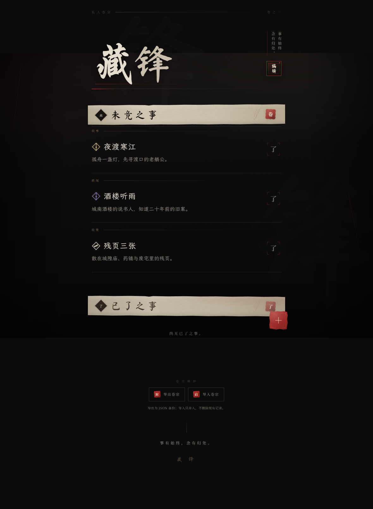
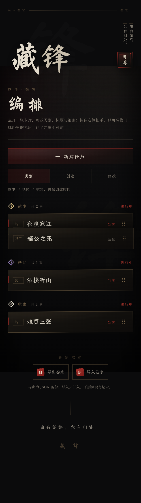

# 藏锋 · WUFENG

> 事有始终，念有归处。
>
> 未竟之事，记于纸上。已了之事，封于朱印。

**当前版本：5.0.0** · [变更记录](CHANGELOG.md)

**在线版本**：https://wyldeye10-spec.github.io/wufeng/

以《影之刃零》的黑暗武侠气质为灵感的极简私人备忘录。它不像待办软件，更像一本存在
于黑暗江湖里的私人卷宗：记事、理脉、落印、留档，仅此而已。






## 功能范围

- 三类任务：**故事**（金剑）、**轶闻**（紫剑）、**收集**（白卷），未竟之事固定按
  故事 → 轶闻 → 收集排列。
- **脉络**：一个系列可以有多件事，只有当前一事出现在「未竟之事」。完成它，下一事
  在同一位置浮现接续；整条脉络走完，它便从未竟中消失，已了之事全部留在卷中。
- **不可逆完成**：点「了」先问「确定吗？／确定后将不可撤销。」，只有「已了」才落印。
  没有撤销，也没有完成后再抹去。
- **控制面板**：右上角「编辑」进入。新建故事/轶闻/收集、添加后续任务、行内改类别、
  标题、细则与逻辑先后、按住把手拖动换序、删除未竟之事（二次确认）。
- 控制面板按卡片堆叠展示每条脉络；单击一张卡片，整叠展开为纸面编辑卡，全部在当前
  页面完成，不另开独立窗口。
- 排序：类别（默认，同类再按创建时间）、创建时间、修改时间。
- 数据保存在本机；导出 UTF-8 JSON 备份，导入按编号并入。
- 标题严格限制 8 个字符，细则严格限制 50 个字符，按用户可感知的 Unicode 字素计数
  （`Intl.Segmenter`，退化路径为码点）。中文输入法组合期间不截断拼音，提交后再校正
  长度。

### 视觉与交互

- 墨黑、烟灰、旧纸白、朱砂、暗铜的完整色彩系统，无霓虹、无彩虹渐变。
- 卷首「藏锋」为毛笔书法；章节标题置于手撕宣纸横幅上；事项以书简式细线排列。
- 未竟/已了事项的标题与正文统一使用霞鹜文楷 GB，标题字号桌面 24px / 移动 22px，
  正文 16px / 15px；行内编辑卡同步使用楷体，标题 29px、移动 24px，正文 16px。
- 标题左侧的任务指引印记改作类别：黑曜菱形内嵌金剑、紫剑、白卷轮廓，按参考图重绘
  为内联 SVG；控制面板与卷宗共用。
- 完成动效改为「落印确认 → 当前事下沉 520ms → 下一事浮现 720ms」；已了之事以纸墨
  淡入。位置由同一脉络接替，不改变其它类别的顺序。
- 控制面板的卡片以负边距叠成一摞，拖动时整叠摊平；展开的编辑卡换成宣纸底、墨字与
  朱砂按钮，沿用原有的撕纸、纸纹与印章语言。
- 撕纸边缘、纸纹、朱印缺边与墨色不匀全部由手写 CSS / 内联 SVG 完成；没有使用游戏
  原画、Logo 或界面素材。
- 键盘焦点、Escape 关闭、焦点陷阱、`prefers-reduced-motion` 降级与安全区适配均已处理；
  拖动把手也支持上下方向键换序。

## 技术结构

| 层 | 实现 |
|---|---|
| UI | React 19 + TypeScript，手写 CSS，无 UI 组件库、无 Tailwind 默认视觉 |
| 构建 | Vite 7，静态资源相对路径，支持任意子目录部署 |
| 持久化 | IndexedDB（首选）→ localStorage（兼容）→ 内存（最后手段，并明确警示） |
| 数据 | `Memo` 增加 `chainId` / `order` / `updatedAt`；旧记录按 `legacy-<id>` 一件一线迁移 |
| 备份 | `wufeng-journal` v3 JSON（兼容 v1/v2）；浏览器内导出/导入，导入按编号并入并单次事务写入 |
| PWA | Web App Manifest、192/512/maskable 图标、构建后生成版本化 Service Worker |
| 字体 | 自托管 Ma Shan Zheng / Noto Serif SC / LXGW WenKai GB 子集（SIL OFL 1.1），不依赖在线字体 |
| 测试 | Playwright Core + 本机 Chrome，22 组端到端验收 |

PRD 将 Tailwind CSS 列为建议项。本项目刻意没有采用：整套界面需要独立的撕纸、印章、
纸纹和排版语言，若用工具类默认风格反而会削弱设计。React、TypeScript、IndexedDB、
PWA 四项核心建议均采用。

## 目录

```text
wufeng/
├─ index.html                    # 页面壳、PWA/Apple meta
├─ package.json
├─ vite.config.ts
├─ tsconfig.json
├─ public/
│  ├─ manifest.webmanifest
│  ├─ favicon.svg
│  ├─ icons/                     # PWA / Apple Touch 图标
│  └─ licenses/                  # OFL 文本与字体署名
├─ scripts/
│  ├─ generate-sw.mjs            # 构建后写入版本化 sw.js
│  ├─ build-fonts.py             # 字体子集流水线（需要源字体）
│  ├─ extract-glyphs.py          # 从字体提取图标字形轮廓
│  └─ build-icons.mjs            # 生成图标 PNG / favicon
├─ src/
│  ├─ App.tsx                    # 卷宗编排、确认、下沉/浮现、焦点
│  ├─ styles.css                 # 完整视觉系统
│  ├─ components/                # Masthead / Studio / TaskForm / MemoRow / SectionBanner / ArchiveTools …
│  ├─ hooks/                     # 存储、可视视口、焦点、减少动态
│  ├─ lib/                       # IndexedDB、脉络与排序、备份格式、字素计数
│  └─ assets/fonts/              # 自托管 WOFF2 子集
├─ .github/workflows/pages.yml   # push main 自动部署 GitHub Pages
├─ tests/
│  ├─ e2e.mjs                    # 端到端验收
│  ├─ last-report.txt            # 最近一次真实运行结果
│  ├─ report.json
│  └─ capture.mjs                # 视觉截图脚本（可选）
├─ releases/                     # 本机版本存档（gitignored）
├─ screenshots/                  # 最终视觉证据
├─ dist/                         # 生产构建（可直接静态部署）
├─ CHANGELOG.md
├─ THIRD_PARTY_NOTICES.md
└─ 参考图/                       # 用户提供的设计参考，不进入构建
```

## 本地运行

环境：Node.js ≥ 20.19（本项目在 Node 24.19 / npm 11.17 下构建与验收）。

```bash
npm install
npm run dev        # http://127.0.0.1:5173
```

开发服务器不会注册 Service Worker；离线与安装能力请在构建后验证：

```bash
npm run build      # TypeScript 检查 → Vite 构建 → 生成 sw.js
npm run preview    # http://127.0.0.1:4173
```

需要让同一局域网的手机访问时：

```bash
npm run build
npx vite preview --host 0.0.0.0 --port 4173
```

手机可打开 `http://<电脑局域网 IP>:4173/`。但 Service Worker 只在 HTTPS 或
localhost 下生效；要在 iPhone 上获得真正的离线和独立窗口能力，请使用 HTTPS 部署。

### 验证

```bash
npm run typecheck
npm run build
npm run test:e2e
```

`test:e2e` 需要本机安装 Google Chrome（默认 `channel: 'chrome'`；也可改成 `msedge`）。
脚本会自行启动 `127.0.0.1:4174` 的 Vite Preview，逐组运行并写出
`tests/last-report.txt` 与 `tests/report.json`。运行前必须先构建。

可选：先启动 `npm run preview`，再运行 `npm run capture`，会用示例卷宗重拍
`screenshots/final-*.png`。

## GitHub Pages

- 线上地址：**https://wyldeye10-spec.github.io/wufeng/**
- 自动部署：`.github/workflows/pages.yml`。推送到 `main` 后会自动执行
  `npm ci` → `npm run build` → 把 `dist/` 发布到 GitHub Pages。
- 仓库设置对应：GitHub → Settings → Pages → Build and deployment →
  Source 选择 **GitHub Actions**。
- iPhone：用 Safari 打开线上地址 → 分享 → 添加到主屏幕。HTTPS 由 GitHub Pages
  提供，Service Worker 与离线缓存可正常工作。
- 线上站点的数据存在该 HTTPS origin 的 IndexedDB 中，与本地 `127.0.0.1` 预览、
  Release 里的静态包互不相通。

## 本地预览

- 构建并启动 `npm run preview` 后：`http://127.0.0.1:4173/`。
- 首次打开后，Service Worker 会预缓存全部外壳资源；断网刷新仍可打开并读取本机卷宗。
- 本页面是纯本地应用，不发起任何业务网络请求。

## 卷宗备份

页脚的「卷宗维护」提供两枚按钮：

- **封 · 导出卷宗**：把当前全部记录写成 UTF-8 JSON 并触发浏览器下载，文件名形如
  `wufeng-backup-20261112-1530.json`。文件在本地生成，不经过服务器。
- **启 · 导入卷宗**：选择 `.json` 备份，校验通过后弹出确认层，写明新增、同号覆盖
  与不变条数；确认后才写入。

备份结构（v3）：

```json
{
  "app": "藏锋",
  "format": "wufeng-journal",
  "version": 3,
  "exportedAt": "2026-11-12T07:30:00.000Z",
  "memos": [
    {
      "id": "…",
      "title": "夜渡寒江",
      "content": "孤舟一盏灯，先寻渡口的老艄公。",
      "icon": "gold-sword",
      "done": false,
      "createdAt": 1794123000000,
      "completedAt": null,
      "updatedAt": 1794123000000,
      "chainId": "…",
      "order": 0
    }
  ]
}
```

导入规则：

- 按 `id` 并入：备份里的新记录追加；同 `id` 记录以备份为准覆盖；未出现在备份中的
  现有记录保留。
- 取消确认、解析失败、格式不符时，卷宗不变。
- 标题 8 字、内容 50 字、完成状态与时间字段都会校验；单文件上限 8 MB、5000 条。
- 仍接受 v1、v2 备份。旧记录没有 `icon` 时回退为故事；没有 `chainId` 时一件自成
  一线，编号为 `legacy-<id>`；没有 `order` / `updatedAt` 时回退为 0 / `createdAt`。
- 备份是明文，含全部标题与正文，请自行保管，不要随手公开。

## 版本与回退

| 版本 | 内容 | 存档 |
|---|---|---|
| 5.0.0 | 当前版本：藏锋、任务类别与脉络、不可逆完成、编辑控制面板、卡片堆叠与拖动排序、备份 v3 | Git tag `v5.0.0` |
| 2.5.0 | 事项标题左侧加入金剑/紫剑/白卷印记 | Git tag `v2.5.0`、`releases/wufeng-2.5.0.zip` |
| 2.0.1 | 卷宗维护，导出/导入 JSON 备份 | Git tag `v2.0.1`、`releases/wufeng-2.0.1.zip` |
| 1.0.3 | 事项标题/正文改用楷体，标题层级加大 | Git tag `v1.0.3`、`releases/wufeng-1.0.3.zip` |
| 1.0.2 | 删除确认层/卷纸层淡出，条目再以墨迹消散 | Git tag `v1.0.2`、`releases/wufeng-1.0.2.zip` |
| 1.0.1 | 落印后未竟条目淡出、已了条目淡入 | Git tag `v1.0.1`、`releases/wufeng-1.0.1.zip` |
| 1.0.0 | 初次交付：完整卷宗、朱印、PWA 与验收 | Git tag `v1.0.0`、`releases/wufeng-1.0.0.zip` |

回退示例（把 `v2.5.0` 换成任意目标 tag 即可）：

```bash
git checkout v2.5.0
npm ci
npm run build
npm run preview
```

源码回退以 tag 为准。版本变更记录见 [CHANGELOG.md](CHANGELOG.md)。

## 数据与安全边界

- IndexedDB：数据库 `wufeng-juanzong`，对象仓库 `memos`，版本 1。
- 兼容存储：`localStorage` 键 `wufeng.memos.v1`。
- 如果 IndexedDB 不可用，会回退到 localStorage 并给出提示；如果两者都不可用，
  只在当前内存中保存，页面会持续显示明确警告。
- 每次新增、编辑、删除、完成、调序都先等待本地事务完成，再更新界面；写入失败时
  不会假装成功。
- 完成不可撤销，已了之事在控制面板中也只能改标题与细则；删除仅限未竟之事。
- 数据只在本机，应用不提供云同步。清除浏览器网站数据、卸载 PWA、更换设备或设备
  损坏后，记录可能不可寻回；导出的 JSON 可作为迁移或恢复手段，但仍需自己保管文件。
- 导出的备份是**明文**，包含全部标题与正文，请自行妥善保存。

## iPhone 添加到主屏幕

1. 将 `dist/` 部署到 HTTPS 地址（Vercel、Netlify、Cloudflare Pages、自己的服务器均可）。
2. 使用 iPhone **Safari** 打开该地址，等待首次加载完成。
3. 点击底部「分享」按钮，选择「添加到主屏幕」，命名为「藏锋」。
4. 从主屏幕图标打开，应用以独立窗口运行，不显示 Safari 地址栏。
5. 首次成功加载并缓存后，可离线打开。

注意：

- HTTP 局域网地址通常不满足 Service Worker 的安全上下文要求；要获得离线与安装
  能力必须用 HTTPS。
- 在 Safari 中「清除历史记录与网站数据」或删除主屏幕图标，可能同时清除本机卷宗。
- iOS 的安装流程无法在桌面自动化环境中物理验证。

## 部署

### Vercel / Netlify

- Build command：`npm run build`
- Output directory：`dist`
- 不需要环境变量、后端或数据库。

### 静态服务器 / Nginx

```nginx
server {
  listen 443 ssl;
  server_name example.com;
  root /var/www/wufeng/dist;
  index index.html;

  location / {
    try_files $uri $uri/ /index.html;
  }

  location = /sw.js {
    add_header Cache-Control "no-cache";
  }
}
```

- `base` 为相对路径，放在子目录（如 GitHub Pages 的 `/wufeng/`）也能正确加载和注册
  Service Worker。
- 带哈希的 `assets/*` 可长期缓存；`sw.js`、`manifest.webmanifest` 不建议长缓存，
  否则新版本卷宗可能延迟生效。
- Service Worker 使用 skipWaiting + clients.claim，新版本激活后下一次刷新会使用新缓存。

## 验收结果

最近一次运行：**22 / 22 通过**。环境为本机 Windows + Chrome（headless）+
Vite Preview。完整输出见 [tests/last-report.txt](tests/last-report.txt)，机器可读
结果见 [tests/report.json](tests/report.json)。

| # | 验收项 | 结果 |
|---|---|---|
| 1 | 首页、藏锋题名、编辑入口、空状态、无页脚存储告知、无横向溢出 | PASS |
| 2 | 新建三类、字数/Emoji、类别顺序、刷新保留 | PASS |
| 3 | 必填校验、改标题/细则/类别、不产生重复 | PASS |
| 4 | 已了二次确认、取消、下沉、下一事浮现顶位、不可撤销 | PASS |
| 5 | 脉络逐事推进、走完消失、已了按完成时间倒序 | PASS |
| 6 | 三类混排、完成只推进本脉 | PASS |
| 7 | 添加后续、类别不变、新卡展开、顺序持久化 | PASS |
| 8 | 按住拖动换序、只在同一脉络内、已了不可拖 | PASS |
| 9 | 排序模式：类别/创建/修改 | PASS |
| 10 | 删除未竟、二次确认、刷新不复活 | PASS |
| 11 | 已了不可撤销、不可抹去、只可修字 | PASS |
| 12 | 中文输入法组合与提交 | PASS |
| 13 | 关闭页面后重开仍保留脉络与已了 | PASS |
| 14 | 导出 v3、脉络字段、文件名 | PASS |
| 15 | 导入 v2 旧备份、同号覆盖、脉络回退、非法文件拒绝 | PASS |
| 16 | PWA 清单、图标、离线重载 | PASS |
| 17 | IndexedDB 不可用 → localStorage 兼容存储 | PASS |
| 18 | 本地存储全部不可用 → 内存警示且可继续记事 | PASS |
| 19 | 移动端 390/320 布局、行内编辑、键盘高度 | PASS |
| 20 | `prefers-reduced-motion` 下完成流程仍可用 | PASS |
| 21 | Escape、焦点归还、确认框默认焦点 | PASS |
| 22 | 楷体字族、标题大于细则、行内编辑同用楷体 | PASS |

**PWA 可安装性检查**：Chrome CDP `Page.getInstallabilityErrors` 只返回
`in-incognito`（自动化使用无痕上下文），没有其他应用配置错误；`Page.getAppManifest`
解析错误为 0。离线重载、图标、字体与 Service Worker 均已实测。

**没有在本环境中物理验证的部分**：

- 没有真机 iPhone / Safari 运行；移动端使用 Chrome 390×844、320×700 与
  390×460 视口模拟，键盘遮挡通过视口收缩模拟，不是真实软键盘。
- 拖动排序在桌面 Chrome 用真实指针事件验证；触屏拖动使用 Pointer Events 与
  `touch-action: none`，未在真机触摸屏上物理验证。
- 导出/导入在 Chrome 桌面与移动模拟中验证；iOS Safari 的「下载到文件」与文件选择器
  未在真机上物理点选。
- 中文输入法通过 Chrome DevTools 的 IME composition 协议验证，没有接入第三方
  输入法客户端。
- Firefox / macOS Safari 未单独跑测试；界面使用的 `clip-path`、`dvh`、
  `backdrop-filter` 在目标 iOS 15.4+ / 现代浏览器可用。

### 验收过程中发现并修复的问题

- 初次实现「添加后续」后仍停留在原任务，连续添笔会把最新一件插到原任务正后方，
  读起来像顺序颠倒。改为添笔后自动展开新任务，链条自然向下生长。
- 卡片负边距过小（-13px）时叠放不明显；调到 -18px 并增加轻微旋转与横向错位，
  在 390px 下仍能完整读到标题。
- 控制面板展开编辑卡后，固定定位的提示条可能压住保存区。取消新增、改记、添笔的
  成功提示，只保留错误与卷宗维护提示，避免遮挡行内操作。
- v2 老备份没有 `chainId` 时，若按随机值迁移，每次读取都会变成新脉络；改为稳定的
  `legacy-<id>`。
- 完成后的 FLIP 补间与下沉/浮现动画互相抢 transform；下沉期间不做条目补间，替换
  后再让下一事以独立动画进入。

## 字体与素材

- 展示字体：Ma Shan Zheng，Copyright 2018 The MaShanZheng Project Authors，OFL 1.1。
- 正文字体：Noto Serif SC，© 2017–2023 Adobe，OFL 1.1；Noto 是 Google Inc. 商标。
- 楷体：LXGW WenKai GB（霞鹜文楷 GB），Copyright 2022–2026 LXGW，
  Copyright 2020 The Klee Project Authors，OFL 1.1；事项标题、正文与编辑卡使用。
- 字体均由本项目子集化并本地分发；不加载 Google Fonts 或其他在线资源。
- 详细署名、许可与依赖许可见 [THIRD_PARTY_NOTICES.md](THIRD_PARTY_NOTICES.md) 与
  [public/licenses/OFL-1.1.txt](public/licenses/OFL-1.1.txt)。
- 除字体轮廓和文字外，无游戏素材；参考图仅作设计参考，不参与构建。

如需重新生成字体或图标（源字体较大，未随项目提交）：

```bash
python -m pip install fonttools brotli
# 将 MaShanZheng-Regular.ttf、LXGWWenKaiGB-Regular.ttf 放到 assets-src/fonts/
python scripts/build-fonts.py --display-source assets-src/fonts/MaShanZheng-Regular.ttf \
  --serif-source "C:/Windows/Fonts/NotoSerifSC-VF.ttf" \
  --kai-source assets-src/fonts/LXGWWenKaiGB-Regular.ttf
node scripts/build-icons.mjs
```

## 已知限制

- 这是纯本地应用，没有任何账号、云同步或多人能力；换设备不会自动带走卷宗。
- 脉络是线性的：一条脉络只有一条先后顺序，不支持分支、条件或并行任务。
- 完成不可撤销，「已了之事」不能改回未竟、不能续写、不能删除；这是刻意设计，用来
  保证进度只向前。
- 记录保存在浏览器站点数据中；清理站点数据、卸载图标、设备损坏均可能导致丢失。
  应用不会自动备份，需要用户自己导出并保管文件。
- 导出的 JSON 是明文备份，不加密；导入按编号覆盖同号记录。
- 字体子集覆盖 GB2312 与界面字符；极生僻字使用系统回退字体。
- 楷体子集约 1.6 MB，Service Worker 首次缓存需要几秒；首次加载后、缓存完成前不要
  立即断网。
- 视觉依赖 `clip-path`、`backdrop-filter`、`dvh`、`visualViewport` 等现代能力；
  不支持时会降级为更朴素的版式，但增删改查不受影响。
- 端到端测试绑定本机 Chrome；换环境请修改 `tests/e2e.mjs` 中的 `channel`。
